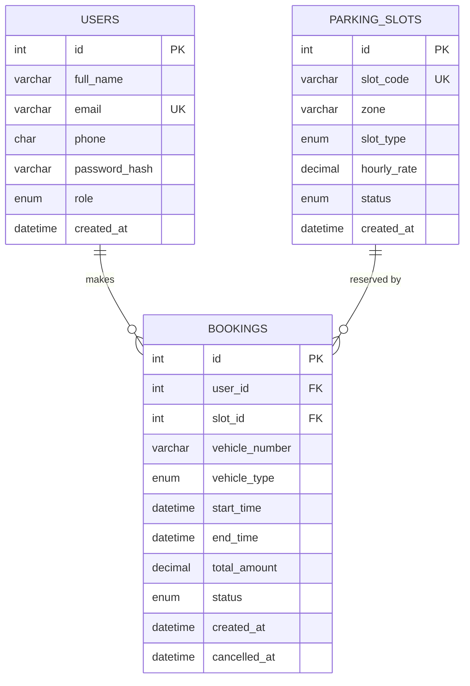

    # 🅿️ Smart Parking Slot Booking System

A college web-development project — a full-stack web app for booking parking slots in real time.

---

## 📋 Feature List

| Category | Feature |
|---|---|
| Auth | Register / Login / Logout with PHP sessions, bcrypt, CSRF |
| Booking | Visual grid (car/bike/EV), auto-refresh every 10 s |
| Booking | Price estimate live in JS, server recalculates on submit |
| Booking | Race-condition-safe slot locking (SELECT … FOR UPDATE) |
| Booking | No overlapping bookings enforced on server + client |
| My Bookings | Tabs: Upcoming / Active / Completed / Cancelled |
| My Bookings | Cancel button (upcoming only), AJAX, no page reload |
| Receipt | Print-friendly receipt with Print button |
| Admin | Dashboard + 7-day revenue bar chart (vanilla canvas) |
| Admin | Manage slots (add/edit/delete, delete protection) |
| Admin | All bookings (search, filter, pagination, cancel) |
| Admin | Users list (view-only) |
| Security | Prepared statements, htmlspecialchars, CSRF, role checks |

---

## ⚙️ XAMPP Setup (Step-by-Step)

### 1. Start XAMPP Services
1. Open **XAMPP Control Panel**
2. Click **Start** next to **Apache**
3. Click **Start** next to **MySQL**

### 2. Place the Project Folder
Copy the `smart-parking` folder to:
```
C:\xampp\htdocs\smart-parking\
```
Your structure should look like:
```
C:\xampp\htdocs\smart-parking\index.php
C:\xampp\htdocs\smart-parking\database\smart_parking.sql
...
```

### 3. Import the Database
1. Open your browser → `http://localhost/phpmyadmin`
2. Click **Import** in the top menu
3. Choose file: `smart-parking/database/smart_parking.sql`
4. Click **Go**

This creates `smart_parking_db` with all tables and 30 seed slots.

### 4. Run the One-Time Setup Script
Open: `http://localhost/smart-parking/setup.php`

This script:
- Creates the **admin** user (`admin@parking.com / Admin@123`) with a real bcrypt hash
- Creates 2 **demo users** (`rahul@demo.com / User@123`, `priya@demo.com / User@123`)
- Inserts **sample bookings** relative to `NOW()` so the demo always shows active + upcoming + completed data

> ⚠️ **Delete `setup.php` after running it once!** It is a security risk if left accessible.

### 5. Open the App
`http://localhost/smart-parking/`

---

## 🔑 Demo Logins

| Role | Email | Password |
|---|---|---|
| Admin | `admin@parking.com` | `Admin@123` |
| User 1 | `rahul@demo.com` | `User@123` |
| User 2 | `priya@demo.com` | `User@123` |

---

## 🗄️ ER Diagram



---

## 🧮 How the Overlap Check Works

**Two bookings overlap** when they share any part of the same time window.

The rule is:
```
new_start  <  existing_end
AND
new_end    >  existing_start
```

**Why this works:**
- If `new_start >= existing_end`, the new booking starts *after* the old one ends → no overlap ✅
- If `new_end <= existing_start`, the new booking ends *before* the old one starts → no overlap ✅
- Otherwise, they share at least one moment in time → overlap ❌

**Back-to-back allowed:** If your booking ends at 2 PM and someone books 2 PM–4 PM, that is fine because `2 PM < 2 PM` is **false**, so no overlap is detected.

**Race condition prevention:** The server opens a transaction and runs `SELECT ... FOR UPDATE` on the slot row, which locks it until the transaction commits. A second concurrent request for the same slot will wait until the first transaction finishes and then find the overlap.

SQL (in `api/create_booking.php`):
```sql
-- Lock the slot row
SELECT id, status, hourly_rate FROM parking_slots WHERE id = ? FOR UPDATE;

-- Overlap check
SELECT id FROM bookings
WHERE slot_id   = ?
  AND status    = 'confirmed'
  AND start_time < ?   -- ? = new_end
  AND end_time   > ?   -- ? = new_start
LIMIT 1;
```

---

## 💰 How Pricing Works

**Rule:** Billed in **whole hours, rounded up**. Minimum 1 hour, maximum 24 hours.

```
total = ceil(duration_in_minutes / 60) × hourly_rate
```

**Examples:**

| Start | End | Minutes | Billed hrs | Rate | Total |
|---|---|---|---|---|---|
| 10:00 | 11:00 | 60 | 1 | ₹40 | ₹40 |
| 10:00 | 11:01 | 61 | 2 | ₹40 | ₹80 |
| 09:00 | 11:30 | 150 | 3 | ₹60 | ₹180 |

The **client shows an estimate** using the same formula. The **server always recalculates** using `calculate_price()` in `includes/functions.php` — the client value is never trusted.

---

## ✅ Manual Test Checklist

### 1. Setup
- [ ] Import `smart_parking.sql` in phpMyAdmin
- [ ] Open `setup.php` — see green success messages
- [ ] Delete `setup.php`

### 2. Landing Page
- [ ] Open `http://localhost/smart-parking/`
- [ ] Live slot availability summary shows counts for Car / Bike / EV
- [ ] "Get Started" → Register page

### 3. Register
- [ ] Fill form with valid data → succeeds, redirected to login with toast
- [ ] Try: name < 2 chars → inline error
- [ ] Try: bad phone format → inline error
- [ ] Try: mismatched passwords → inline error
- [ ] Try: duplicate email → server error

### 4. Login
- [ ] Login as `rahul@demo.com / User@123` → redirected to book.php
- [ ] Try: wrong password → "Invalid email or password" (vague, no enumeration)

### 5. Booking Grid
- [ ] Select "Car" → grid shows Zone A slots in green/red/grey
- [ ] Change time range → grid refreshes, available count updates
- [ ] Slot A-01 should show red (occupied by seeded booking)
- [ ] Select an available slot → turns blue, price estimate appears
- [ ] Check price: 2-hour car = ₹80, 3-hour EV = ₹180, etc.
- [ ] Leave vehicle number blank → click Confirm → toast error
- [ ] Enter invalid vehicle number → toast error
- [ ] Enter `KA01AB1234` → click Confirm → modal with summary appears
- [ ] Verify modal shows correct slot, duration, amount
- [ ] Click "Confirm & Pay" → toast "Booking confirmed", redirect to receipt

### 6. Receipt
- [ ] Receipt shows all details: slot, vehicle, times, duration, amount
- [ ] Click Print → browser print dialog opens

### 7. My Bookings
- [ ] Go to My Bookings → "Upcoming" tab shows the new booking
- [ ] Seeded booking (A-01) shows in "Active" tab
- [ ] Past seeded booking (B-02) shows in "Completed"
- [ ] Cancelled booking (C-02) shows in "Cancelled"
- [ ] Click "✕ Cancel" on an upcoming booking → confirm dialog → booking removed from Upcoming

### 8. Overlap Check
- [ ] Book the same slot and overlapping time as an existing booking
  → Server returns 409: "Sorry, this slot was just booked"
  → Grid refreshes, conflicting slot now shows red

### 9. Logout
- [ ] Click Logout → redirected to login
- [ ] Try accessing `book.php` directly → redirected to login

### 10. Admin Panel
- [ ] Login as `admin@parking.com / Admin@123`
- [ ] Dashboard shows stat cards and 7-day bar chart
- [ ] **Slots**: Add a new slot (e.g. D-01, Zone D, car, ₹50/hr) → appears in table
- [ ] Edit D-01 → change rate to ₹55 → updated
- [ ] Delete D-01 (no bookings) → deleted
- [ ] Try deleting A-01 (has bookings) → error: "upcoming bookings"
- [ ] **Bookings**: Search for "Rahul" → filtered results
- [ ] Filter by status "confirmed" → shows only confirmed
- [ ] Cancel an upcoming booking → status changes
- [ ] **Users**: View user list — no edit controls

---

## 🗂️ Folder Structure
```
smart-parking/
├── index.php           Landing page
├── register.php        Registration
├── login.php           Login
├── logout.php          Session destroy
├── book.php            Slot grid + booking
├── my_bookings.php     User booking history
├── receipt.php         Print-friendly receipt
├── setup.php           ⚠️ One-time seeder (delete after use)
├── includes/
│   ├── db.php          Database connection
│   ├── auth.php        Session / CSRF helpers
│   ├── functions.php   Price calc, validation, flash
│   ├── header.php      Shared header + nav
│   └── footer.php      Shared footer
├── api/
│   ├── get_slots.php        GET  slots + availability JSON
│   ├── create_booking.php   POST create booking (transaction)
│   └── cancel_booking.php   POST cancel booking
├── admin/
│   ├── index.php       Dashboard + chart
│   ├── slots.php       Slot CRUD
│   ├── bookings.php    All bookings
│   └── users.php       Users list
├── assets/
│   ├── css/style.css   All styles
│   └── js/
│       ├── book.js     Slot grid + booking flow
│       ├── validate.js Client-side validation
│       ├── admin.js    Canvas bar chart
│       └── toast.js    Toast notifications
├── database/
│   └── smart_parking.sql  Schema + slot seed data
└── README.md
```

---

## 🛡️ Security Highlights

- **Prepared statements** everywhere — no raw SQL from user input
- **`htmlspecialchars()`** on all output via `h()` helper
- **CSRF token** on every POST form and API call (header `X-CSRF-Token`)
- **`session_regenerate_id(true)`** on login (prevents session fixation)
- **`password_hash()` / `password_verify()`** (bcrypt, default cost)
- **Role checks** on every admin page and API endpoint
- **`SELECT … FOR UPDATE`** in a transaction for race-condition-safe booking

---

*Built for college web development submission. PHP + MySQL + Vanilla JS/CSS. No frameworks, no CDN dependencies.*
